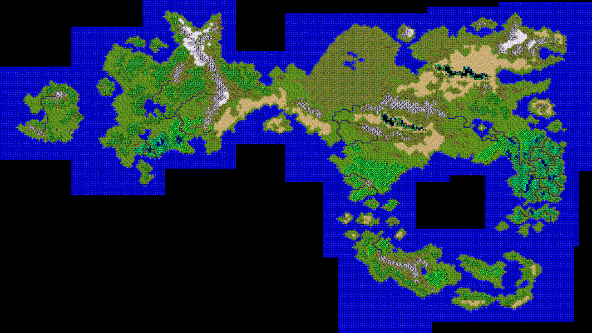
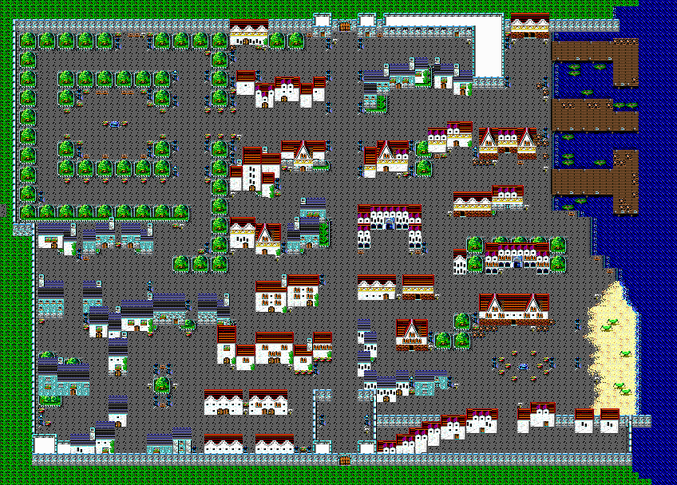

# Magic Candle II — data file formats

Status legend: **confirmed** = parsed and visually/round-trip verified on all files; **partial** = works on most files, exceptions listed; **unknown** = not yet decoded.

All integers little-endian. Tiles are 16×16 pixels. Reference parser: `tools/mc2fmt.py`; renderer: `tools/render.py`, `tools/render_all.py`.

## `Vnn.MCT` — VGA tileset (confirmed, 25 files)

| offset | size | meaning |
|---|---|---|
| 0 | 768 | palette: 256 × (r,g,b), 8-bit values (VGA 6-bit ×4, e.g. `a8`, `fc`) |
| 768 | 2 | magic `0x0108` (unknown meaning, constant) |
| 770 | 2 | tile count N (256 for V01, 128 for all others) |
| 772 | 2 | tile width, height = 16, 16 |
| 774 | N×256 | tiles, each 256 bytes of 8-bit palette indices, row-major |

File size = 774 + 256·N exactly (66,310 or 33,542). No per-tile metadata; passability etc. must live elsewhere.

## `Enn.MCT` — EGA tileset (confirmed structure, 38 files, 16,896 B each)

| offset | size | meaning |
|---|---|---|
| 0 | 256 | 128 × uint16 tile offsets, relative to byte 256; always 0,130,260,… |
| 256 | 128×130 | tiles: 2-byte header `08 10` (8 bytes/row, 16 rows) + 128 bytes of 4bpp pixels (high nibble = left pixel) |

Rendered with the standard 16-colour EGA palette the tiles look right. Not needed for the port (VGA is the target) but documents the 2.00 "VGA only" split: E files are leftover from the original release.

## `*.MCM` — map blocks (confirmed)

Loaded by `_LoadMap(num, set, letter)` into `struct MAPTYPE { u8 map_xl; u8 map_yl; u8 map_body[3636]; }` (filename template `M00E00.MCM`, letter and digits patched in; max 3638 bytes read). **The `**` marker is literally `map_xl = map_yl = 42 (0x2A)`.**

| file | header | body | count | role |
|---|---|---|---|---|
| `Mbb Ett.MCM` | `2A 2A` | 42×42 tile indices, row-major | 150 | block *bb* drawn with tileset `Vtt.MCT`; placed into a location by its `D` record (below) |
| `Gnn E00.MCM` | per chunk `0B 09` | N consecutive chunks of 2 + 11×9 bytes | 13 | combat arenas: `_LoadMap` with letter `G` (only caller: `_DoACmbt`); the `E00` is never substituted |
| `M07/11/14 E93.MCM` | `2A 2A` | 5040 bytes, autocorrelation says 84 wide | 3 | **unresolved**: engine would read only the first 3638 bytes; does not align with sibling blocks |
| `M07E65.MCM` | `54 3C` = 84,60 | 84×60 + 78 junk bytes | 1 | **unresolved**, header honours the (xl,yl) convention |
| `G04E00.MCM` | | 3 valid chunks then zeros, 1766 B | 1 | probably a stale file |

A block holds **no** flags or layers; walkability etc. come from the tileset's `B` table.

### Locations are mosaics of blocks

A location record (`Dnn.MCV`, below) lists blocks with `(block, tileset, x, y)`. Blocks are placed on a **32×34 grid stride** but are 42×42, so neighbours overlap by 10 columns / 8 rows. Verified on every location: overlapping cells are identical (a handful of 1–25-cell differences in the world map, presumably late edits — later blocks win). `mapsizex/mapsizey` = `32·cols + 10` × `34·rows + 8`, e.g. Telermain = 3×2 blocks = 106×76.

The world map ("Nameless", `D01`, 19 blocks, tilesets 01 and 23) and Telermain (`D02`) composed by `tools/loc.py`:

 

Six `MxxE80.MCM` blocks are referenced by **no** location record and no `V80` tileset exists; still unresolved (overlay code may reference them).

## `Dnn.MCV` — location record (confirmed = `struct LOCTYPE`, 5062 B max)

Loaded by `_LoadVar('D', n)` straight into `_loc`; the first 20 words are offsets relative to the start of the record and are relocated to pointers in place (loop runs 20 times when word 0 ≥ 0x1F). See `docs/structs.h` for the full struct. Fixed header:

| off | field | notes |
|---|---|---|
| 0 | 20 × u16 | `roomptr genptr knpcptr resids maps loctext lkdata pgmptr exitptr gwrds newsr weathr peopr hroomptr spetbl treasptr spdoors locptr locevptr notyet0` |
| 40 | `locnum` | |
| 41 | `roomno` | |
| 42 | `locname[11]` | e.g. `Telermain M`, `Oshcrun`, `Dorak 3   X` (trailing letter looks like a class code: M town, X dungeon) |
| 53 | `lcharm` | |
| 54,55 | `mapsizex, mapsizey` | 11×9 for single-room interiors (store, tavern, library …) |
| 56–61 | `doorstn locdiff pearlsw greetmsgs[3]` | |
| 62 | `thedata[5000]` | the sub-tables pointed to above |

Sub-table `maps`: byte **before** the pointer target is the count *n* (0xFF = none); then four parallel arrays of *n* bytes: `block[]`, `tileset[]`, `x[]`, `y[]`. Other sub-tables are arrays of the small structs in `structs.h` (`ROOM`, `GEN`, `KNPC`, `RESID`, `PGM`, `EXIT`, `SPECIAL`, `NEXTLOC`, `HROOM`) — layouts known, semantics TODO.

Some `D` files (`D06, D15–D18, D36, D55, D60`) are not `LOCTYPE` images (garbage names, size 0) — different record kind, TODO.

## `Bnn.MCV` — per-tileset tile data (confirmed = `struct TDATATYPE`, 1012 B max)

Loaded by `_LoadTiles(n)` right after `Vnn.MCT`; six leading u16 offsets are relocated. Tables for 128 tiles:

| ptr | content |
|---|---|
| `txttbl` | NUL-separated name pool ("a bridge", "grassland", "a plant", "a door" …) |
| `txtptr` | 128 bytes: name index per tile |
| `walkptr` | list(s) of tile ids terminated by `FF` — walkability classes (exact semantics TODO) |
| `aniptr` | animation sequences, `FF`-terminated groups |
| `doorptr` | door tile pairs |
| `colorptr` | 128 bytes: minimap colour per tile |

## Filename templates in the EXE (DS = seg 15B5)

`I00.MCT` tileset (first char → `V` VGA / `E` EGA; `I` = CGA/Tandy), `B00.MCV` tile data, `I00.MCI` + `.MCC` creature tiles via `_LoadFolks/_LoadCTile` (packed 129-byte tiles, index file of u16 offsets), `M00E00.MCM` map block, `P00.MCO` code overlay (`_LoadOvly`, loaded at 1CA8:0000 into a 16 KB buffer, entered via `_LocPgm`), `V00.MCO` variable overlay (`_LoadVvly`), `D00.MCV` location, `FFFAR.MCO` far code loaded once at startup (`_Hello`).

## Other extensions (unknown)
`Cnn.MCV`, `Rnn.MCV` text with offset tables (conversation / NPC names), `MCE` screens, `E00/E01.MCC` creature tile packs, `MCS`/`MCI` saves, `CMF`/`MID` music, `VOC` sfx.
